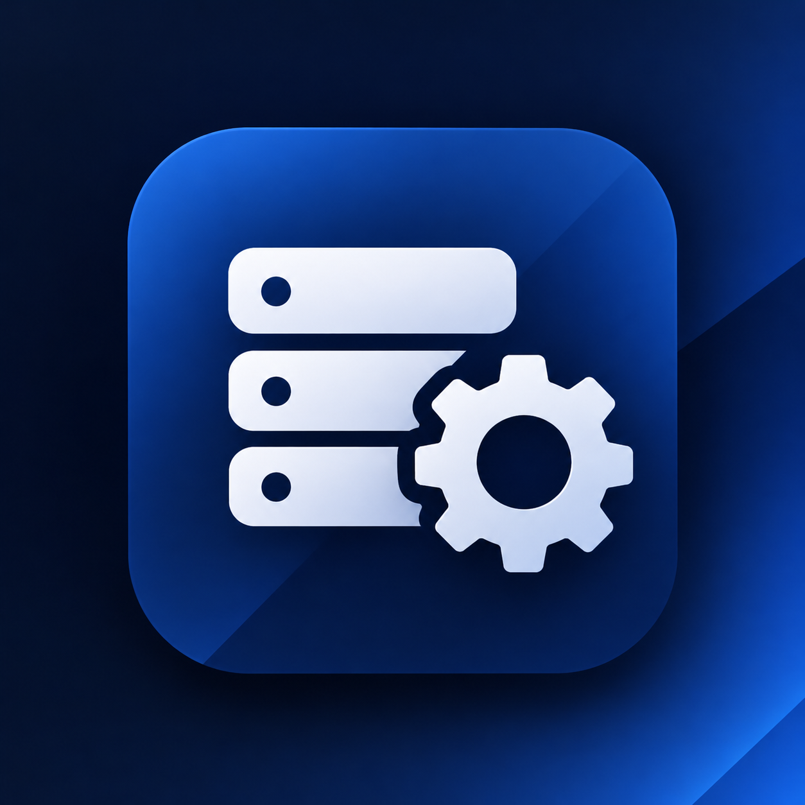

# 🚀 MCP Manager

<p align="center">
  
</p>

<p align="center">
  <b>Le gestionnaire officiel tout-en-un pour vos serveurs MCP (Model Context Protocol) sur Windows.</b><br>
  Pilotez vos serveurs locaux (Node.js, Python, uv...), connectez Claude Desktop ou vos IA distantes en un clic avec <b>Tailscale Funnel</b>, et profitez des mises à jour automatiques via GitHub.
</p>

---

## 👶 Qu'est-ce que c'est (en très simple) ?

Imaginez que les **MCP** sont des super-pouvoirs que vous donnez à une Intelligence Artificielle (accéder à des fichiers, chercher sur GitHub, piloter votre navigateur, etc.).

Normalement, lancer et configurer ces serveurs est très compliqué : il faut taper des commandes bizarres dans des terminaux noirs, gérer des ports réseau, et tout recommencer si la fenêtre se ferme.

**MCP Manager fait tout à votre place avec une belle interface Windows :**
- 🟢 **Démarrer / Arrêter** n'importe quel MCP en cliquant sur un bouton.
- ⚡ **Démarrage automatique** de tous vos serveurs dès que vous ouvrez l'application (désactivé par défaut, activable dans les Réglages).
- 🌍 **Partage sécurisé sur Internet** grâce à **Tailscale Funnel** pour que des IA en ligne (Mammouth AI, Claude Web, etc.) puissent parler à vos serveurs locaux en HTTPS sécurisé sans ouvrir votre box Internet.
- 🔄 **Mise à jour automatique** : dès qu'une nouvelle version sort sur GitHub, une alerte vous le signale à l'ouverture de l'application ou d'un clic dans les réglages.
- 🛡️ **Sécurité maximale** : vos clés secrètes et tokens sont automatiquement chiffrés avec la sécurité native de Windows (DPAPI). Personne d'autre ne peut les lire.

---

## 📥 Guide d'installation pas à pas (même si vous débutez)

### Option 1 : Installer avec l'installateur officiel (Recommandé)

1. Rendez-vous sur la page GitHub du projet : [Releases](https://github.com/Bubulle-nmkz/MCP-Manager/releases).
2. Téléchargez le fichier **`MCP-Manager-Setup.exe`**.
3. Double-cliquez dessus pour lancer l'installation :
   - *Si Windows affiche un écran bleu « Windows a protégé votre ordinateur », cliquez sur **« Informations complémentaires »** puis sur **« Exécuter quand même »**.*
4. L'installateur installe tout tout seul dans `C:\Program Files\MCP Manager`.
5. **C'est fini !** Un raccourci avec le beau logo bleu **MCP Manager** apparaît directement sur votre Bureau.

---

### Option 2 : Compiler le projet depuis le code source (Pour les développeurs)

Si vous voulez modifier le code ou générer vous-même l'installateur :

#### Prérequis nécessaires sur votre PC
1. **Windows 10 ou 11 (64 bits)** avec le **Mode Développeur** activé (*Paramètres Windows > Système > Espace développeurs*).
2. **Visual Studio Community** (avec la charge de travail *« Développement Desktop en C++ »* et le *SDK Windows*).
3. **Rust** : [installer Rust via rustup.rs](https://rustup.rs/) (choisir `x86_64-pc-windows-msvc`).
4. **Flutter** : [installer Flutter](https://docs.flutter.dev/get-started/install/windows) (canal stable).
5. **Inno Setup 6** : pour créer le fichier `Setup.exe` (`winget install JRSoftware.InnoSetup -e`).

#### Commandes pour compiler et créer le Setup
Ouvrez une console **PowerShell** dans le dossier du projet :

```powershell
Set-Location "C:\Users\natha\Documents\MCP\MCP-Manager-v3\mcp-work"

# 1. Compiler le coeur Rust et l'application Flutter Windows Release
.\scripts\build.ps1

# 2. Créer l'installateur officiel (dist\MCP-Manager-Setup.exe)
$iscc = (Get-ChildItem -Path "C:\Program Files*\Inno Setup*", "$env:LOCALAPPDATA\Programs\Inno Setup*" -Filter "ISCC.exe" -Recurse | Select-Object -First 1).FullName
& "$iscc" .\scripts\installer.iss

# 3. Lancer l'installation
Start-Process .\dist\MCP-Manager-Setup.exe
```

---

## 🌐 Guide complet : Configurer Tailscale Funnel (Pas à pas pour les débutants)

### Pourquoi faire cela ?
Votre ordinateur est chez vous, protégé par votre Box Internet. Les IA sur le Web (comme Mammouth AI ou Claude Web) ne peuvent pas entrer dans votre PC pour discuter avec vos serveurs MCP locaux.  
**Tailscale Funnel** crée un tunnel magique et 100% sécurisé (en HTTPS officiel avec cadenas vert) entre votre ordinateur et Internet, **sans rien toucher à votre Box Internet**.

### Étape 1 : Créer un compte Tailscale (Gratuit)
1. Allez sur le site officiel : **[https://tailscale.com](https://tailscale.com)**
2. Cliquez sur le bouton **« Get Started »** ou **« Try for free »**.
3. Connectez-vous avec votre compte Google, Microsoft ou GitHub.

### Étape 2 : Installer Tailscale sur votre PC Windows
1. Téléchargez l'application officielle : **[https://tailscale.com/download/windows](https://tailscale.com/download/windows)**.
2. Installez le logiciel en suivant les invites.
3. Une petite icône Tailscale apparaît en bas à droite de votre écran (près de l'horloge).
4. Cliquez dessus et connectez-vous avec le même compte que vous venez de créer à l'Étape 1.

### Étape 3 : Activer « Funnel » sur votre compte Tailscale
> ⚠️ **Important :** Par sécurité, Tailscale demande une fois d'activer le partage public.

1. Ouvrez votre tableau de bord sur Internet : **[https://login.tailscale.com/admin/dns](https://login.tailscale.com/admin/dns)**.
2. Vérifiez que **« MagicDNS »** est bien activé (c'est activé par défaut).
3. Allez dans l'onglet **Access Controls (ACL)** : [https://login.tailscale.com/admin/acls](https://login.tailscale.com/admin/acls).
4. Ajoutez la permission `node:funnel` si ce n'est pas déjà fait :
```json
"nodeAttrs": [
  {
    "target": ["autogroup:member"],
    "attr": ["funnel"]
  }
]
```

### Étape 4 : Activer le Funnel dans MCP Manager
1. Ouvrez **MCP Manager** sur votre Bureau.
2. Allez dans l'onglet **« Tailscale Funnel »** à gauche.
3. Vous y trouverez le statut en direct de Tailscale :
   - Si Tailscale est lancé sur votre PC, MCP Manager détecte automatiquement votre nom de machine (ex: `mon-pc.tailnet.ts.net`).
4. Cliquez sur **« Activer le Funnel HTTPS »**.
5. MCP Manager vous donne alors votre adresse web publique sécurisée, par exemple :
   `https://mon-pc.tailnet.ts.net/mcp/mon-serveur`
6. Vous pouvez copier cette adresse et la coller directement dans votre client IA (Mammouth AI, Claude, etc.) !

---

## ⚙️ Paramètres et Fonctionnalités Clés

### 1. Démarrage automatique des serveurs MCP
- Ouvrez **MCP Manager** et cliquez sur **« Paramètres »** (roue crantée).
- Activez la case **« Démarrer tous les MCP automatiquement à l'ouverture de l'application »**.
- Dès la prochaine ouverture de l'application, tous vos serveurs configurés passeront automatiquement au vert sans aucun clic !

### 2. Vérification des mises à jour
- **Automatique :** À chaque ouverture, MCP Manager regarde sur GitHub si une version plus récente existe. Si oui, une fenêtre apparaît avec le détail et vous propose de la télécharger.
- **Manuelle :** Dans l'onglet **Paramètres**, cliquez sur le bouton **« Rechercher une mise à jour »**. Si vous êtes déjà à jour, un badge vert vous rassure immédiatement.

### 3. Réduire dans la barre de notification
- Si vous fermez la fenêtre (la croix rouge en haut à droite), l'application ne s'éteint pas : elle se réduit discrètement dans la zone de notification Windows (près de l'horloge) avec son logo bleu.
- Double-cliquez sur l'icône bleue près de l'horloge pour rouvrir la fenêtre à tout moment.
- Pour quitter définitivement l'application, faites un clic droit sur l'icône près de l'horloge > **« Quitter »**.

---

## ❓ FAQ & Dépannage (En cas de problème)

#### « Mon serveur MCP refuse de démarrer (voyant rouge) »
1. Vérifiez que le langage nécessaire à ce serveur est bien installé sur votre PC (ex: **Node.js** si la commande commence par `npx`, ou **Python** si c'est `uv`/`python`).
2. Cliquez sur la carte du serveur puis sur **« Voir les logs »** pour lire le message d'erreur exact envoyé par le serveur.

#### « La recherche de mise à jour me dit que la passerelle est introuvable »
Assurez-vous que l'application a bien démarré son moteur interne. Le voyant d'état en bas à gauche de la fenêtre doit afficher **« Passerelle connectée »** en vert.

#### « Comment sauvegarder mes configurations ? »
Toutes vos configurations et clés d'accès sont stockées dans votre dossier personnel Windows :  
`%APPDATA%\MCPManager\`  
Vous pouvez sauvegarder ce dossier si vous changez d'ordinateur.

---

## 📄 Licence
Ce projet est sous licence open-source libre. Voir le fichier [LICENSE](LICENSE) pour plus d'informations.
